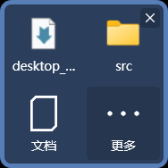
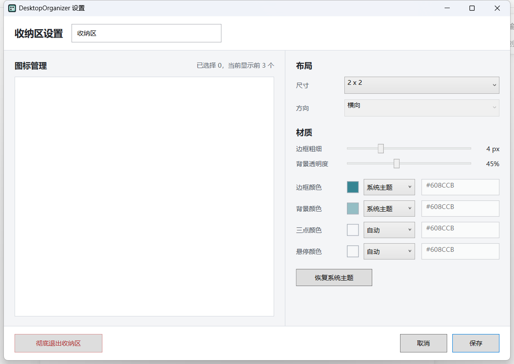

<p align="center">
  
</p>

# DesktopOrganizer

适用于 Windows 10/11 的桌面图标收纳工具。将常用应用、文件、文件夹和快捷方式集中到半透明收纳区，保留单击打开、布局调整与托盘管理能力。

[下载安装包](https://github.com/MPomelo/DesktopOrganizer/releases/latest) · [使用手册](USER_GUIDE.md) · [报告问题](https://github.com/MPomelo/DesktopOrganizer/issues) · [MIT 许可](LICENSE)

## 功能特性

- **灵活布局**：支持 `2 × 2`、`1 × 4`、`2 × 4` 尺寸，后两种可切换横向或纵向。
- **外观设置**：调整背景透明度、边框粗细和颜色，支持系统主题色与自定义颜色。
- **拖放导入**：添加应用、文件、文件夹、`.lnk` 快捷方式与 `.url` 网址快捷方式。
- **图标管理**：单击打开，支持重命名、排序、删除和外露选择；通过三点入口展开全部图标。
- **托盘操作**：显示、隐藏收纳区，或保留配置退出软件。
- **安全释放**：关闭收纳区时预览图标释放位置；桌面容量不足的项目进入开始菜单，操作带恢复日志和失败回滚。

## 界面预览

**桌面收纳区**



**收纳区设置**



<details>
<summary>查看图标释放确认界面</summary>


</details>

## 下载与安装

系统要求：**64 位 Windows 10 22H2 或 Windows 11**。

前往 [GitHub Releases](https://github.com/MPomelo/DesktopOrganizer/releases/latest)，根据需要选择：

| 文件 | 用途 |
| --- | --- |
| `DesktopOrganizer-Setup-<版本>-x64.exe` | 安装版，支持选择安装位置及创建快捷方式 |
| `DesktopOrganizer-<版本>-win-x64-portable.exe` | 便携版，直接运行 |
| `SHA256SUMS.txt` | 校验发布文件的完整性 |
| `USER_GUIDE.md` | 完整使用手册 |

发布包自带所需的 .NET 运行环境，使用时无需另装 .NET SDK。安装程序不要求管理员权限，但所选目录需对当前用户可写。

当前发布包未做代码签名，Windows SmartScreen 可能显示提示。请从本仓库 Releases 下载，并核对同版本的 `SHA256SUMS.txt`。以 v1.0.0 安装包为例：

```powershell
Get-FileHash .\DesktopOrganizer-Setup-1.0.0-x64.exe -Algorithm SHA256
```

## 快速使用

1. **启动与设置**：首次启动会显示默认 `2 × 2` 收纳区并打开设置窗口；调整布局与外观后点击“保存”。已有配置会在启动时恢复。
2. **添加项目**：从文件资源管理器拖入文件、文件夹或快捷方式。导入桌面 `.lnk` 时，可选择托管快捷方式或只保存引用。
3. **打开与管理**：单击图标打开项目；左键单击三点入口展开全部图标，右键单击三点入口打开设置。
4. **选择退出方式**：临时不用时通过托盘隐藏或退出；不再使用收纳区时，在设置中选择“彻底退出收纳区”，确认释放图标后结束软件。

| 操作 | 结果 |
| --- | --- |
| 隐藏收纳区 | 临时隐藏，配置和图标不变，可从托盘恢复 |
| 退出软件 | 结束进程，保留配置和托管图标，下次启动恢复 |
| 关闭收纳区 | 确认后释放图标并删除当前收纳区，软件仍在托盘运行 |
| 彻底退出收纳区 | 确认后释放图标、删除当前收纳区并退出软件 |

卸载前建议先执行“彻底退出收纳区”；**卸载程序不会自动释放仍被托管的图标**。详细操作、释放规则与故障排查见 [使用手册](USER_GUIDE.md)。

## 开发与构建

### 环境要求

- Windows 10 22H2 或 Windows 11。
- .NET 8 SDK。
- Windows PowerShell 5.1 或 PowerShell 7。

本项目借助 AI 编程工具开发，基于 .NET 8、WPF 和 Windows Shell API。

### 获取源码并运行

```powershell
git clone https://github.com/MPomelo/DesktopOrganizer.git
cd DesktopOrganizer

dotnet build .\DesktopOrganizer.sln --configuration Debug
dotnet run --project .\src\DesktopOrganizer.App\DesktopOrganizer.App.csproj
```

### 运行测试

```powershell
dotnet run --project .\tests\DesktopOrganizer.Tests\DesktopOrganizer.Tests.csproj --configuration Debug
```

Windows UI 冒烟测试使用隔离的配置、桌面和开始菜单目录：

<details>
<summary>查看 UI 测试命令</summary>

先构建 Debug 版本，再运行：

```powershell
.\scripts\Stage4.UiSmoke.ps1
.\scripts\Stage5.UiSmoke.ps1
.\scripts\Stage6.UiSmoke.ps1
.\scripts\Stage7.UiSmoke.ps1
```

</details>

### 生成发布包

```powershell
.\scripts\Build-Release.ps1
```

脚本生成图标、构建并测试 Release、发布自包含的 `win-x64` 单文件应用，再使用 Windows 自带的 IExpress 生成安装包与 SHA-256 校验文件。输出位于 `artifacts/release/`，无需另装 Inno Setup、NSIS 或 WiX。

推送 `v*` 标签会触发 [Windows 发布工作流](.github/workflows/release.yml)，构建并上传发布文件。

## 项目结构

| 路径 | 说明 |
| --- | --- |
| `src/DesktopOrganizer.App/` | WPF 应用、视图模型、配置与 Windows Shell 服务 |
| `tests/DesktopOrganizer.Tests/` | 自动化测试 |
| `installer/` | 安装与卸载脚本 |
| `scripts/` | 构建、图标生成和 UI 测试脚本 |
| `artifacts/` | 界面截图与本地发布输出 |
| [USER_GUIDE.md](USER_GUIDE.md) | 详细使用说明、故障排查与文件说明 |

## 数据与文件安全

- 普通文件、文件夹和应用只保存引用，不会移动原文件。
- 仅在用户明确同意托管时，桌面 `.lnk` 会移入 `%AppData%\DesktopOrganizer\ManagedShortcuts`；其指向的应用或文件不会移动。
- 图标释放前写入恢复日志，关键操作失败时尝试回滚；不要手动删除未完成事务的恢复日志。
- 配置、图标缓存与日志位于 `%AppData%\DesktopOrganizer`。卸载时可选择是否保留用户数据。

## 参与贡献

欢迎通过 [Issues](https://github.com/MPomelo/DesktopOrganizer/issues) 提交问题或建议，也欢迎提交 Pull Request。报告问题时请注明 Windows 版本、软件版本、复现步骤及相关日志；提交前移除私人路径等敏感信息。

## 开源许可

本项目采用 [MIT License](LICENSE)。
