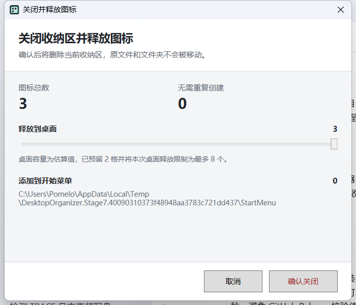

# DesktopOrganizer


DesktopOrganizer 是一个适用于 64 位 Windows 10/11 的桌面图标收纳工具，由AI工具使用 .NET 8、WPF 和 Windows Shell API 开发。

## 下载

请从 GitHub Releases 下载：

```text
DesktopOrganizer-Setup-1.0.0-x64.exe
```

安装程序支持自定义安装位置，并包含运行所需的 .NET 环境。正式 Release 同时提供 SHA-256 校验值和便携版可执行文件。

当前发布包未进行商业代码签名，SmartScreen 可能显示警告。请只从本项目 Releases 下载并核对 `SHA256SUMS.txt`。

## 主要功能

- `2 x 2`、`1 x 4`、`2 x 4` 三种收纳区尺寸。
- `1 x 4`、`2 x 4` 支持横向和纵向。
- 半透明背景、粗边框、系统主题色及自定义颜色。
- 拖放导入文件、文件夹、应用、`.lnk` 和 `.url`。
- 单击启动，三点入口展开全部图标。
- 图标重命名、排序、删除和外露选择。
- 托盘显示、隐藏和退出。
- 关闭时根据桌面容量释放图标，溢出项进入开始菜单。
- 文件事务、失败回滚和崩溃恢复日志。
- 设置中的“彻底退出收纳区”会在确认并安全释放图标后结束软件。

启动软件会自动显示收纳区并打开设置窗口。详细安装和使用说明见 [USER_GUIDE.md](USER_GUIDE.md)。

## 截图



## 开发环境

- Windows 10 22H2 或 Windows 11
- .NET 8 SDK
- PowerShell 5.1 或 PowerShell 7

```powershell
dotnet build .\DesktopOrganizer.sln --configuration Debug
dotnet run --project .\src\DesktopOrganizer.App\DesktopOrganizer.App.csproj
```

## 测试

```powershell
dotnet run --project .\tests\DesktopOrganizer.Tests\DesktopOrganizer.Tests.csproj --configuration Debug
```

Windows UI 冒烟测试：

```powershell
.\scripts\Stage4.UiSmoke.ps1
.\scripts\Stage5.UiSmoke.ps1
.\scripts\Stage6.UiSmoke.ps1
.\scripts\Stage7.UiSmoke.ps1
```

测试使用隔离的配置、桌面和开始菜单目录，不会写入真实用户桌面。

## 构建安装包

```powershell
.\scripts\Build-Release.ps1
```

发布脚本会：

1. 生成应用图标。
2. 构建 Release。
3. 运行自动化测试。
4. 发布自包含的 `win-x64` 单文件应用。
5. 使用 Windows 自带 IExpress 生成单文件安装程序。
6. 输出 SHA-256 校验值。

输出目录：

```text
artifacts\release\
```

推送 `v*` 标签也会触发 [.github/workflows/release.yml](.github/workflows/release.yml)，生成可下载的 Windows 构建产物。

## 数据安全

- 普通文件和文件夹只保存引用，不会被移动。
- 只有用户明确选择托管的桌面 `.lnk` 会移动到 `%AppData%\DesktopOrganizer\ManagedShortcuts`。
- 关闭释放操作在删除配置前写恢复日志，失败时逆序回滚。
- “退出软件”保留收纳区；“彻底退出收纳区”会先提示并释放图标。

配置和日志位于 `%AppData%\DesktopOrganizer`。

## 项目结构

```text
src/DesktopOrganizer.App/    WPF 应用
tests/DesktopOrganizer.Tests 自动化测试
installer/                   安装与卸载脚本
scripts/                     构建、图标和 UI 测试脚本
artifacts/                   截图与本地发布输出
```

各目录和关键文件的详细说明见 [USER_GUIDE.md](USER_GUIDE.md#14-项目文件说明)。

## 开源许可

本项目使用 [MIT License](LICENSE)。根目录中的 Windows `.exe` 仅作为本地发布产物保留，并已被 Git 忽略；正式下载文件应上传到 GitHub Release 的附件中。
